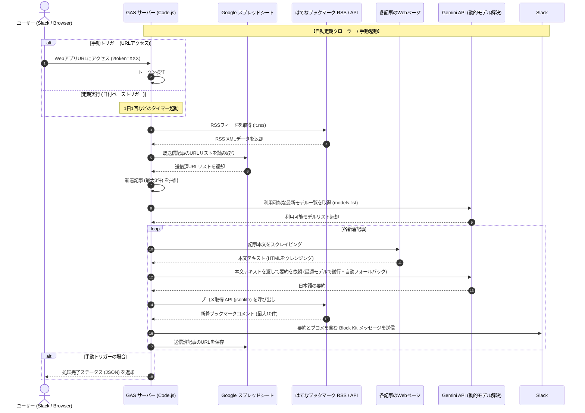

# AI はてなブックマーク ダイジェスト (ai-hatebu-digest)

はてなブックマークのホットエントリー（テクノロジーカテゴリ）から記事を自動取得し、Geminiで要約したものをSlackに通知する、**Google Apps Script (GAS)** と **Google スプレッドシート** を使った完全無料のシステムです。

---

## 🚀 システム概要



### 💡 主な機能・仕様
1. **全自動定期実行 (1日1回など)**:
   - はてなブックマークのテクノロジーホットエントリーから新着記事を自動取得。
   - スプレッドシートの送信済履歴と比較し、重複するURLは自動除外（送信済履歴は最大100件まで保持され、古いものから自動削除されます）。
   - 各記事の本文をスクレイピングし、Gemini APIを使用して要約。
   - はてなブックマークのEntry APIから新着コメント（ブコメ）を最大10件取得。
   - 新規記事（最大3件）をSlackチャンネルへ整形して通知。
2. **堅牢性とエラーハンドリング**:
   - **実行時間・API制限への配慮と5段階の多段階安全終了ガード**: GASの実行時間制限（最大6分/360秒）およびGemini APIの無料枠制限（15 RPM）を考慮し、1回あたりの最大処理件数を **3件** に制限。また、各外部通信（`UrlFetchApp.fetch`）の直前で残り時間を監視する **5段階のタイムアウト安全監視ガード** を搭載：
     1. **2分00秒（120秒）超過**: 新規記事の処理開始を安全に打ち切り（未着手の記事は次回実行時に再処理されます）。
     2. **2分20秒（140秒）超過**: 記事本文スクレイピングのフェッチをスキップし、要約スキップ通知へ縮退。
     3. **2分40秒（160秒）超過**: Gemini APIのリトライ・フォールバック試行を即座に打ち切り。
     4. **3分30秒（210秒）超過**: はてなブコメ取得APIのフェッチをスキップ。
     5. **4分00秒（240秒）超過**: Slack通知送信のフェッチをスキップし、履歴保存のみ行って安全終了（GAS強制終了上限の6分に対し120秒以上の安全マージンを常時確保）。
     さらに短時間連続リクエストによる過負荷（HTTP 503）を防ぐため、後続記事がある場合かつ時間余裕がある場合のみ記事処理間に **2.5秒のウェイト** を挿入し、各工程の開始・完了および所要時間を `console.log` に可視化。
   - **例外処理の徹底とクラッシュリカバリ（再試行ループ完全防止）**: 各記事の処理を独立した `try-catch-finally` で囲み、一部の記事でスクレイピングや要約、通信エラー等の重大な例外が発生しても残りの記事の処理を継続。さらに、`try-catch` で捕捉できない **GAS 6分強制終了（タイムアウト）** にも対応するため、記事処理開始時にスクリプトプロパティ（`IN_PROGRESS_ARTICLE`）へ処理中URLを記録する Write-Ahead Log 方式を採用。万が一タイムアウトで強制終了した場合でも、次回起動時に自動検知して該当記事を送信済履歴へ登録・スキップ（Slackへ自動復旧警告を通知）するため、連日のタイムアウト再試行ループを確実に遮断します。
   - **アクセス不可・非テキスト・巨大HTML・短文記事の安全なスキップ・記録**: 記事本文が403/404エラー等で取得できない場合や、`Content-Type` がHTML/テキスト以外（PDF、画像、バイナリ等）の場合は即座にスキップ。HTMLクレンジングでは生HTMLを先頭 **200,000文字** で切り詰めたうえで、`<script>` / `<style>` / `<noscript>` を線形時間 $O(N)$ で除去して正規表現バックトラッキング（CPUハング）を防止し、先頭 **6,000文字** を要約対象として抽出します。抽出された本文テキストが極端に短い場合（**150文字未満**。Cloudflareによるボット防御画面や、SPAサイトの空のスケルトンHTMLの可能性があるため）も要約をスキップし、Slackに警告（⚠️）とスキップ理由を通知。スキップされた記事も送信済履歴（スプレッドシート）に追加されるため、二重に処理されることはありません。
   - **Gemini APIの特性分散型動的モデル解決と自動フォールバック・適正サーキットブレーカー**: 処理開始時に `models.list` APIから利用可能なモデル一覧を動的に取得し、テキスト生成に対応したFlash系モデルから「①最新の軽量Liteモデル（高速かつ過負荷耐性が高く、GASの6分制限下での定時要約に最適）」「②最新の標準モデル（Lite系が利用不可・過負荷時のフォールバック先）」「③最も成熟した安定モデル（インフラが確立）」を自動選定して候補リスト（上位最大3件）を編成します。モデル名は一切ハードコードされておらず、新モデル登場時や旧モデル廃止時も自動追従します。出力トークン数上限（`maxOutputTokens: 2048`）および Gemini 2.5系モデル向けの思考トークン抑制（`thinkingConfig: { thinkingBudget: 0 }`）を設けて応答遅延を抑止し、3.x系など他世代モデルでの不要な HTTP 400 を回避します。さらに `thinkingConfig` 付きリクエストで HTTP 400 が返った場合はエラー文言に依存せず（APIキー不正等の認証エラーを除き）自動的に `thinkingConfig` を除外して即時再試行（以降の記事でも自動除外）し、除外後も 400 が返るモデル固有の非互換時は次候補モデルへフォールバックします。一時的な過負荷（HTTP 503）時は指数バックオフで再試行（ただし1回の試行に **15秒以上** かかって失敗した場合は同一モデル再試行を省き即座にフォールバック）し、失敗時は次候補モデルへ自動フォールバックします（フォールバックで成功したモデルは次回記事で優先利用されます）。一時的な過負荷で1つの記事が全モデル失敗しても後続記事を巻き添えにせず要約を継続し、1日の利用枠枯渇（HTTP 429）やAPIキー不正・全モデル共通の HTTP 400 などの回復不能な恒久エラー時のみサーキットブレーカー（Gemini要約スキップ）が作動します。安全フィルター（SAFETY等）でブロックされた場合はエラー理由（`理由: SAFETY` など）を要約欄に表示します。
3. **Slack上での情報完結**:
   - Slackの Block Kit 形式で、記事タイトル、Gemini要約、新着ブコメがスッキリとまとまったメッセージを配信。
   - モバイルやPCのSlackアプリからダイレクトに要約とユーザーの反応を確認可能。
4. **手動更新 (Webhook)**:
   - GASでデプロイしたWebアプリURLにアクセス（トークン付き）することで、いつでも手動で最新の情報を取得・要約・Slack送信可能。
5. **ランニングコスト0円**:
   - ホスティング & API: Google Apps Script (0円)
   - データベース: Google スプレッドシート (0円)
   - AI要約: Gemini API (Google AI Studio: 0円, 15 RPM)
6. **GASエラー通知メール監視 & GitHub Issue 自動起票（任意）**:
   - 別トリガー（`watchGasFailureEmails`）により、Gmail に届く GAS エラー通知メール（`noreply-apps-scripts-notifications@google.com`）を24時間定期監視。
   - 対象プロジェクトのエラー通知を検知すると、HTMLテーブル（またはプレーンテキスト抜粋）から発生時刻・関数名・エラーメッセージを抽出し、GitHub REST API 経由で自動的に Issue を起票。起票後は Slack へ Issue リンク付きで通知。
   - 重複起票防止はメッセージIDの永続化（スクリプトプロパティ `REPORTED_GAS_FAILURE_MSG_IDS`、最大100件保持）で行い、可視化のために Gmail 処理済みラベルも付与するため、ユーザーが先にメールを既読にしたり Gmail のスレッドまとめ機能が有効であっても取りこぼしや二重起票が発生しません。

---

## 🛠️ スクリプトプロパティ設定 (環境変数)

GASのプロジェクト設定で、以下のスクリプトプロパティ（Script Properties）を設定します。

| プロパティ名 | 必須/任意 | 説明 |
| :--- | :--- | :--- |
| `GEMINI_API_KEY` | 必須 | Google AI Studioから取得したGemini APIキー |
| `SLACK_WEBHOOK_URL` | 必須 | 通知させたいSlackチャンネルのIncoming Webhook URL |
| `APP_SECRET` | 必須 | 手動更新用URLに含める任意のパスワード（トークン）文字列 |
| `HATENA_RSS_URL` | 任意 | 取得対象のRSS。デフォルトは `https://b.hatena.ne.jp/hotentry/it.rss` |
| `GITHUB_TOKEN` | 任意 | GASエラー通知からGitHub Issueを自動起票するための Fine-grained Personal Access Token（対象リポジトリの `Issues: Read and write` 権限のみ付与）。未設定時は自動起票をスキップ |
| `GITHUB_REPO` | 任意 | Issue起票先リポジトリ（`owner/repo` 形式）。デフォルトは `lightyield/ai-hatebu-digest` |
| `GAS_FAILURE_PROJECT_FILTER` | 任意 | 監視対象とするGASプロジェクト名（カンマ区切り）。デフォルトは `ai-hatebu-digest,無題のプロジェクト`（`*` または空文字で全プロジェクト対象） |
| `GAS_FAILURE_PROCESSED_LABEL` | 任意 | 処理済みメールに付与するGmailラベル名。デフォルトは `gas-failure-reported`（未存在時は自動作成） |
| `GITHUB_ISSUE_LABELS` | 任意 | 自動起票するIssueへ付与するラベル名（カンマ区切り）。未設定時はラベルなし |

---

## 📱 手動更新の利用方法

1. **アクセスURL**:
   - GASでデプロイしたWebアプリのURLに、設定した `APP_SECRET` をパラメータとして付与してアクセス（ブラウザや外部APIクライアント等からGETリクエスト）します。
   - 例: `https://script.google.com/macros/s/XXXXX/exec?token=YOUR_SECRET_STRING`
2. **レスポンス**:
   - 正常に完了すると `{"success": true, "processedCount": X}` のようなJSONが返却されます。

---

## ⚙️ セットアップ手順

1. **スプレッドシートの作成**:
   - 新規の Google スプレッドシートを作成します。
   - シート名を「Articles」にしておきます（送信済URLの履歴保存用。送信済履歴は自動的に最大100件まで保持され、古いものから自動削除されます）。
2. **Apps Script を開く**:
   - メニューの「拡張機能」 > 「Apps Script」を選択します。
3. **コードの配置**:
   - デフォルトで作成されている `コード.gs`（または `Code.gs`）に、[src/Code.js](src/Code.js) のコードを貼り付けます。
4. **スクリプトプロパティの設定**:
   - 左メニューの歯車アイコン（プロジェクトの設定）をクリックします。
   - 画面下部の「スクリプトプロパティ」セクションで、「スクリプトプロパティを追加」をクリックし、`GEMINI_API_KEY`、`SLACK_WEBHOOK_URL`、`APP_SECRET` を設定し保存します。
5. **ウェブアプリのデプロイ (手動更新を利用する場合のみ)**:
   - 右上の「デプロイ」 > 「新しいデプロイ」をクリックします。
   - ギアアイコン（種類の選択）をクリックし、「ウェブアプリ」を選択します。
   - 以下のように設定します：
     - 次のユーザーとして実行: **自分**
     - アクセスできるユーザー: **全員**
   - 「デプロイ」をクリックし、承認プロンプトが表示された場合は許可します。
   - 発行された **「ウェブアプリのURL」** をコピーします。
6. **定期実行トリガーの設定**:
   - 左メニューの目覚まし時計アイコン（トリガー）をクリックします。
   - 右下の「トリガーを追加」をクリックします。
   - 以下のように設定します：
     - 実行する関数を選択: `runCron`
     - 実行するデプロイを選択: `Head`
     - イベントのソースを選択: **時間主導型**
     - 時間ベースのトリガーのタイプを選択: **日付ベースのタイマー**
     - 時刻を選択: **午前 7時〜8時**（お好みの時間）
   - 「保存」をクリックします。
7. **GASエラー通知メール監視トリガーの設定（任意・Issue自動起票を利用する場合）**:
   - （推奨）Apps Script エディタ左上のプロジェクト名を `ai-hatebu-digest` に変更しておくと、複数プロジェクト運用時にも件名で確実に識別できます。
   - GitHub の Settings > Developer settings > Personal access tokens > Fine-grained tokens から、対象リポジトリのみに `Issues: Read and write` 権限を付与したトークンを発行し、GAS のスクリプトプロパティ `GITHUB_TOKEN` に設定します。
   - Apps Script エディタ上で関数 `watchGasFailureEmails` を選択して一度手動実行し、Gmail アクセス権限の承認プロンプトを許可します。
   - 左メニューの「トリガー」 > 「トリガーを追加」から以下を設定します：
     - 実行する関数を選択: `watchGasFailureEmails`
     - 実行するデプロイを選択: `Head`
     - イベントのソースを選択: **時間主導型**
     - 時間ベースのトリガーのタイプを選択: **時間ベースのタイマー**
     - 時間の間隔を選択: **1時間おき**（お好みの間隔）
   - 「保存」をクリックします。

---

## 🧪 ローカルテストの実行

本プロジェクトでは、Google Apps Script (GAS) のグローバルオブジェクトを Jest 上でモック化し、ローカル環境で単体テストを実行できるようにしています。

### テストの実行手順
1. **依存パッケージのインストール**:
   ```bash
   npm install
   ```
2. **テストの実行**:
   ```bash
   npm test
   ```

### テストの構成・特徴
- **モック化**: `PropertiesService`, `UrlFetchApp`, `XmlService`, `SpreadsheetApp`, `ContentService`, `Utilities`, `GmailApp` などの GAS 固有クラスを Jest で擬似的に再現し、通信やストレージを伴わない高速なテストを実現しています。
- **検証範囲**: [src/Code.test.js](src/Code.test.js) にて、トークン認証、エラーハンドリング、二重送信防止、Gemini APIの動的モデル取得とLite優先・特性分散フィルタリング・最大件数制限、Gemini 2.5系限定の `thinkingBudget: 0` による思考抑制と汎用400時の自動除外再試行・モデル固有400時のフォールバック・APIキー不正400時の即時サーキットブレーカー、一時的な API 障害時のリトライ/リカバリ処理、遅延503時の即時フォールバック、一時的過負荷（503）時の後続継続処理、直前成功モデルの優先昇格、レートリミット（429）時の即時サーキットブレーカー、アクセス不可記事・非テキスト（PDF等）・短文コンテンツのスキップ仕様、巨大HTML・不正タグの安全な線形時間クレンジング、Gemini APIの安全性フィルターブロック時のハンドリング、5段階の多段階実行時間上限ガード機能、重大例外・タイムアウト強制終了時のクラッシュリカバリ（再試行ループ防止）、および GASエラー通知メールの解析・プロジェクトフィルタ・GitHub Issue自動起票・重複起票防止・Slack連携など、全65件のテストケースを網羅しています。
- **本番との互換性**: [src/Code.js](src/Code.js) の末尾で `module.exports` をエクスポートする際、GASのランタイム環境を壊さないためのガード処理（`typeof module !== 'undefined'`）を施しています。

---

## 🤖 CI/CD デプロイ自動化

GitHub Actions を利用し、`main` ブランチへのマージ/プッシュをトリガーにテスト実行と GAS へのデプロイを自動で行います。

### CI/CD フロー
1. `main` ブランチへプッシュ
2. GitHub Actions ワークフロー（[.github/workflows/deploy.yml](.github/workflows/deploy.yml)）が起動
3. `npm ci` による依存関係のクリーンインストール
4. `npm test` による Jest テストの実行 (全テストがパスすることを確認)
5. シークレットから `.clasprc.json` と `.clasp.json` を生成
6. `clasp push -f` を実行し、[src/Code.js](src/Code.js) などのソースコードを GAS にデプロイ

### GitHub Secrets の設定
リポジトリの Settings > Secrets and variables > Actions に以下のシークレットを登録する必要があります。

| Secret名 | 内容 |
| :--- | :--- |
| `CLASPRC_JSON` | `~/.clasprc.json` の内容（ローカルで `npx clasp login` を実行して生成された認証用JSONデータ） |
| `CLASP_JSON` | `.clasp.json` の内容（`scriptId` や `rootDir` などの設定情報を含むJSONデータ。セキュリティのためリポジトリにはコミットされません） |